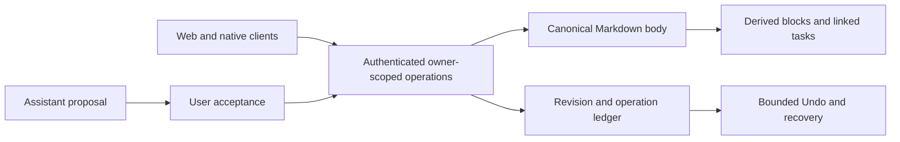

# Tempo Flow technical requirements

Updated 2026-10-21. Documentation draft for review; implementation and live acceptance are separate.

## Architecture

Web and mobile are thin clients over the existing root `convex/` backend. Shared packages keep reusable UI, types and utilities. There is one canonical page body, one owner-scoped write path and disposable derived indexes. Do not introduce a second backend or auth authority while consolidating the documents.

## Persistence contracts

| Record class | Authority and rules |
|---|---|
| Page body | `notes.body`; exact bytes/line-ending preservation where contract requires; no second rich-text authority |
| Derived blocks | Rebuilt atomically from the body; never become an independent editor store |
| Linked tasks | Stable IDs across removal and revival; linked writes route through the canonical writer |
| Page operations | Idempotent request identity, revision/digest checks and content-free metadata |
| Undo payloads | Separate transient content with reviewed physical cleanup; a timestamp alone does not prove expiration |
| Assistant requests | Per-conversation ordering and ownership; stale/late completions rejected after cancel or replacement |
| Memory | Save only accepted material; retain source attribution and distinct explicit/inferred links |
| Resources | Separate explicit retained-file class; same-origin authenticated byte access |

Changes to existing schema are additive unless a reviewed widen/migrate/narrow plan exists. A structural validator or fake test harness cannot prove transactional races, backend limits or deployed behavior.

## Explicit file resources

- What: User-picked raster images, PDF, plain text and Markdown are a separate retained resource class; broader file classes and automatic content processing are excluded. Evidence status: OWNER_DEFAULTS_WITH_HELD_ACTIVATION.
- When: decided 2026-10-12 (first seen 2026-10-12)
- Why: EXTRAPOLATED synthesis: Provide user-owned files without silently broadening RAM-only imports.
- How: Recorded defaults include 4 MiB/file, 50 MiB and 100 ready files/user, canonical body links and authenticated same-origin byte access. Detailed schema/proxy/retry/range contracts are proposals; spend, privacy activation, purge and feasibility remain open. Current runtime is UNKNOWN; cited source claims were not rerun.
- Status: MVP
- From: [S93](https://github.com/Levidavidspublic/tempo-rhythm/blob/52bf2803e9105b25c2538aedd81a754a9fbfdedb/docs/contracts/CORE-WEB-RESOURCES.md)

## Deletion, restoration and export

- What: Five-minute action Undo, thirty-day restore eligibility, account reactivation and physical data purge are different claims. Evidence status: CONFLICTING_DEFAULT_CONTRACTS.
- When: decided UNKNOWN (first seen 2026-10-12)
- Why: EXTRAPOLATED synthesis: Avoid promising recovery or deletion that a UI window or sign-in alone does not establish.
- How: Hard rules describe eventual purge and JSON ZIP/email export; later notes/resources audits find no purge and specify narrower per-file/live-item exports. Linked IDs and resources add retention constraints. No blanket DSR completion claim. Current runtime is UNKNOWN; cited source claims were not rerun.
- Status: MVP
- From: [S66](https://github.com/Levidavidspublic/tempo-rhythm/blob/52bf2803e9105b25c2538aedd81a754a9fbfdedb/docs/HARD_RULES.md), [S92](https://github.com/Levidavidspublic/tempo-rhythm/blob/52bf2803e9105b25c2538aedd81a754a9fbfdedb/docs/contracts/CORE-WEB-NOTES.md), [S93](https://github.com/Levidavidspublic/tempo-rhythm/blob/52bf2803e9105b25c2538aedd81a754a9fbfdedb/docs/contracts/CORE-WEB-RESOURCES.md), [S297](https://github.com/Levidavidspublic/tempo-rhythm/pull/728#discussion_r4294252943), [S289](https://github.com/Levidavidspublic/tempo-rhythm/pull/728#discussion_r4294257175)

## Ownership and data minimization

- What: Every operation must enforce owner/approval/lifecycle boundaries; raw imports are transient unless a separate explicit resource class authorizes retention.
- When: decided UNKNOWN (first seen 2026-10-05)
- Why: Prevent cross-user disclosure and unreviewed persistence.
- How: Default optional-string ownership target differs from tolerated existing user IDs. Resource, memory, notes, linked tasks and account deletion need their own exact lifecycle contracts.
- Status: MVP
- From: [S66](https://github.com/Levidavidspublic/tempo-rhythm/blob/52bf2803e9105b25c2538aedd81a754a9fbfdedb/docs/HARD_RULES.md), [S80](https://github.com/Levidavidspublic/tempo-rhythm/blob/52bf2803e9105b25c2538aedd81a754a9fbfdedb/docs/TRD.md), [S92](https://github.com/Levidavidspublic/tempo-rhythm/blob/52bf2803e9105b25c2538aedd81a754a9fbfdedb/docs/contracts/CORE-WEB-NOTES.md), [S93](https://github.com/Levidavidspublic/tempo-rhythm/blob/52bf2803e9105b25c2538aedd81a754a9fbfdedb/docs/contracts/CORE-WEB-RESOURCES.md)

## Bounded queries and derived records

- What: The contracts specify cursor, row and byte bounds, safe projections and stable linked IDs; broad historical collect-based queries remain audited gaps.
- When: decided UNKNOWN (first seen 2026-10-12)
- Why: Keep old records reachable without unsafe scans or hidden truncation.
- How: Source fake handlers do not prove backend validators/index/pagination behavior. Runtime byte limits, split handling and several generated-API ownership steps remain UNKNOWN.
- Status: MVP
- From: [S92](https://github.com/Levidavidspublic/tempo-rhythm/blob/52bf2803e9105b25c2538aedd81a754a9fbfdedb/docs/contracts/CORE-WEB-NOTES.md), [S5](https://github.com/Levidavidspublic/tempo-rhythm/blob/e7a120e2a07011768d04ea080d443448ee760dbb/docs/kitchen/kb/tickets/KB-01.md), [S20](https://github.com/Levidavidspublic/tempo-rhythm/blob/e7a120e2a07011768d04ea080d443448ee760dbb/docs/kitchen/kb/tickets/KB-16.md), [S288](https://github.com/Levidavidspublic/tempo-rhythm/pull/728#discussion_r4294257626)

## Tempo MCP server

- What: An authenticated remote MCP server exposes eleven planner tools for tasks, notes, calendar, Today plan and brain dump. Evidence status: DOCUMENTED_IMPLEMENTATION.
- When: decided UNKNOWN (first seen 2026-10-16)
- Why: EXTRAPOLATED synthesis: Let external assistants operate approved users' Tempo data.
- How: Source documents hashed per-user tokens, revocation, approval/origin limits and proxy statuses. No live client/endpoint test occurred in extraction. This server is the opposite direction from Tempo-as-Executor-client research. Current runtime is UNKNOWN; cited source claims were not rerun.
- Status: Gen 1
- From: [S125](https://github.com/Levidavidspublic/tempo-rhythm/blob/52bf2803e9105b25c2538aedd81a754a9fbfdedb/docs/ops/MCP.md), [S296](https://github.com/Levidavidspublic/tempo-rhythm/pull/728#discussion_r4294253564)

## Executor client and external action research

- What: Tempo-as-client OAuth discovery, encrypted connection lifecycle, narrow tool discovery and exact external-action approval are proposed. Evidence status: RESEARCH_AND_PROPOSED_TICKETS.
- When: decided UNKNOWN (first seen 2026-10-16)
- Why: EXTRAPOLATED synthesis: Connect users' apps without guessing that a tool name implies safe read-only behavior.
- How: Hosted protocol, grants, pricing, token rotation, revocation and runtime support remain UNKNOWN. First researched flow reads catalog only; external writes, heavy-write meaning and five-minute Undo exception remain unresolved. Current runtime is UNKNOWN; cited source claims were not rerun.
- Status: Gen 1
- From: [S128](https://github.com/Levidavidspublic/tempo-rhythm/blob/52bf2803e9105b25c2538aedd81a754a9fbfdedb/docs/research/EXECUTOR-IN-TEMPO.md), [S230](https://github.com/Levidavidspublic/tempo-rhythm/issues/1118), [S234](https://github.com/Levidavidspublic/tempo-rhythm/issues/1114), [S235](https://github.com/Levidavidspublic/tempo-rhythm/issues/1113)
## Concurrency and failure behavior

Every save carries the expected revision and request identity. A repeated request with the same accepted payload is idempotent; a reused request identity with changed payload fails. Stale saves retain the user's draft and expose a recoverable state. Save requests serialize where the editor contract requires it.

Assistant requests use a bounded queue and generation epoch. Completion must recheck active ownership, account/conversation tombstones and the epoch before committing. Queued future prompts must not leak into an earlier request's context. A cancelled or replaced request cannot later overwrite the accepted state.

Undo is an operation with a deadline and conflict policy. It must not erase a newer unrelated edit or let an older completion dismiss a newer Undo. Reject/timeout/retry paths need the same owner and revision checks as a happy path.

## Read projections and integrations

Queries are bounded by row, byte and cursor limits. Safe projections must not leak protected block payloads, raw imports or another account's material. Source attribution and explicit acceptance survive imports. Connector discovery grants no authority to execute a tool; external writes require an exact action preview and explicit confirmation. Irreversible outcomes must never be presented as universally undoable.

## Required evidence

1. Unit/contract tests cover byte fidelity, malformed fences, mixed direction, task identity, revision conflicts and idempotence.
2. Backend tests cover ownership denial, inactive accounts, foreign/deleted objects, bounded traversal, concurrent claims and cleanup.
3. Browser evidence covers actual routes, loading/error/offline states, keyboard focus, accepted mutation/reload/Undo and failed-save recovery.
4. Native evidence uses the actual platform and assistive tooling; HTML prototypes do not satisfy it.
5. Report the exact frontend/backend revisions and environment. Current runtime and deployment validation were not performed by this documentation task.

Commands and required checks remain those in the current repository instructions and factory/SLOTS.md. No dependency, schema, generated API or environment change is authorized by this document alone.

## Latest default-branch change checked during this run

On 2026-10-21 the default branch advanced to `c7447ad9ad5a71326b211d1de80d54091a280683`. The six changed paths implement KB-67 selected-reminder phrase editing plus styles, localized copy, tests and evidence. No canonical contract or repository instruction changed in that delta.

The recorded behavior keeps drafts, validation and suggestion feedback attached to the selected reminder ID; delayed responses cannot clear another draft or overwrite newer text. Suggestions persist only after explicit acceptance. The committed evidence reports 27 hydrated fixture passes and 3,328 unit passes, with two unrelated local E2E failures and 89 credential-gated skips. These are author-reported fixture results, not new tests in this run or live-account proof. The pre-existing derived-suggestion acceptance path still lacks its own Undo toast; native review and live behavior remain UNKNOWN.

Issue #1169 is now closed after PR #1172. This was an independently observed repository change, not an issue action performed by this documentation task.

Source: [KB-67 evidence](https://github.com/Levidavidspublic/tempo-rhythm/blob/c7447ad9ad5a71326b211d1de80d54091a280683/docs/polish/evidence/kb-67-phrase-drafts-stay-with-the-selected-nag.md).

## Default branch snapshot on 2026-10-21: additional recovery and focus work

The pinned default branch snapshot is `542f2cf361a595cc6e4556ba742ff3c4368d0374`. Relative to the preceding snapshot, five changes add the following behavior without changing canonical product contracts or repository instructions:

- KB-61: a submitted habit-sheet save owns only its originating sheet instance. Closing and reopening cannot let an old response close or alter a new draft; closing does not cancel the underlying save.
- KB-64: note Undo failures stay in the existing notice, with explicit retry inside the original absolute deadline. Duplicate activation is guarded; accepted work can settle after the deadline without overriding successful parent navigation. Fulfillment alone is not a restoration receipt.
- KB-70: notification actions guard duplicate submissions and preserve focus that has moved away from the pending row.
- KB-73: the landing theme control has a localized next-action accessible name, a 44 px target and visible keyboard focus.
- KB-74: the narrow navigation drawer contains keyboard focus, makes the background inert, supports dismissal and restores an appropriate visible opener. Other overlays and route navigation retain their own focus ownership.

The committed evidence reports focused fixture passes, but also failed or unknown local required checks for several changes. Those failures remain material despite reported remote CI success. This documentation task did not repeat the tests. Live persistence, device screen readers and native-language review remain UNKNOWN.

Public evidence is under `docs/polish/evidence/` at the pinned snapshot, in the KB-61, KB-64, KB-70, KB-73 and KB-74 Markdown reports.
