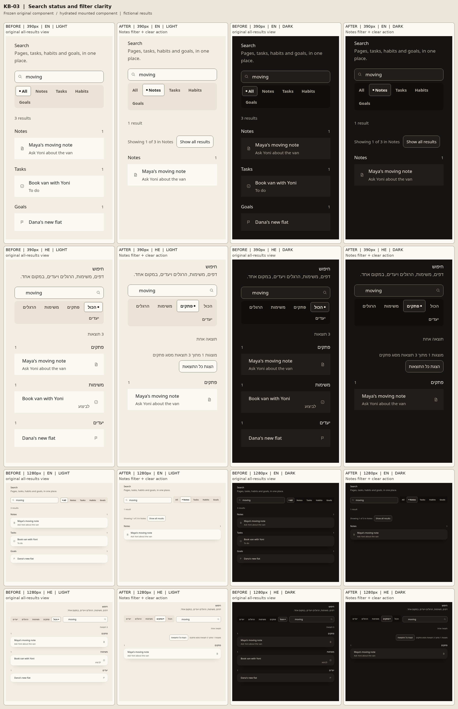

# KB-03 — search states and focus

The mounted `/search` component keeps the last settled result list visible while a new query is pending. Its separate status region announces the pending state or the newly settled count once. A category with no matches explains that other results remain and offers a clear-filter button that returns focus to the query. The 250 ms debounce, URL `q` parameter and existing search query call remain unchanged.

## Capture method and limits

The **before** frames come from the checked-in `SearchScreenBody` and `SearchHeader` rendered *before editing them*, using the original module and its existing `ResultGroup`, `translate` and v3 styles. The baseline source was frozen in ignored `work/before/SearchScreen.tsx` at SHA-256 `ff0b0d55fef523a0f58b9f24c47673395b855459722c9277d7abd7b4c9bae449`; the original HTML was generated before the first implementation edit. The screenshots use that frozen HTML. The input and results are fictional (`Maya`, `Dana`, `Yoni`), and this is an isolated production-component fixture, not an authenticated route capture.

The **after** frames use the actual changed `SearchScreenBody` inside a hydrated loopback browser fixture. A local stub supplies the same fictional results through the unchanged query call. The after frames select the Notes category to show the new filter summary and clear action. The baseline shows all categories, so the sheet compares layout and status treatment, not an identical selected filter. The contact sheet shows 390 and 1280 px, English and Hebrew, light and dark; dark captures wait for the resolved text color. The gallery also captures default results separately in ignored `work/` screenshots.

## Browser interaction findings

- The new `SearchStatus` is a single atomic status announcement, separate from the changing result list. Loading leaves the last settled rows visible until the new result arrives; zero total and zero selected-category states use distinct copy.
- Left/right arrows wrap through the filter radio group and reverse horizontally in Hebrew. Enter from the query focuses the first result. Clearing a filter returns focus to the query.
- The hydrated gallery exercises initial, results, no-match, loading, error, disabled and long-result states, plus language switching and retry. Browser checks cover reduced motion, 44 px phone targets, large text, one `h1`, one `main`, and no viewport overflow at both widths.

The fixture aliases `react-native` to the installed `react-native-web` only for its bundle and replaces backend/navigation imports only inside the loopback harness. Device VoiceOver/TalkBack and authenticated `/search` results remain **UNKNOWN**. Hebrew is machine-drafted and needs Amit's native read.
