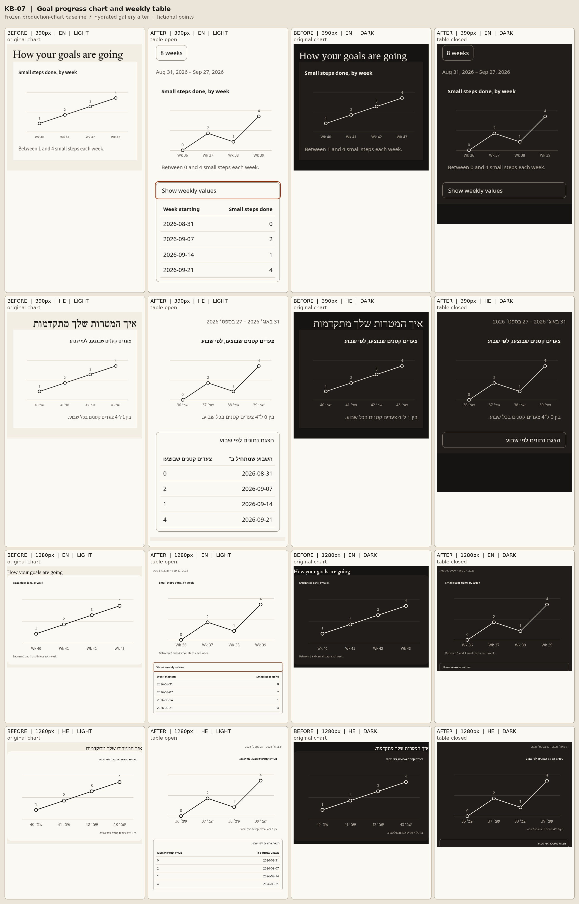

# KB-07 — weekly goal progress values

The mounted `/goals/progress` screen now places a disclosure and semantic two-column table directly below its weekly chart. Both use the existing `WeekPoint` values. The chart's SVG is decorative to assistive technology; the visible summary and the table provide the same information in words and numbers. The date range labels both views. A week with zero completed tasks shows `0` without judgment.

## Capture method and limits

The **before** images were captured *before changing the mounted component*. A temporary Bun script extracted the exact original `WeeklyChart` JSX from `GoalsProgressScreen.tsx`, supplied fictional weekly points, and rendered it with the checked-in `linePoints`, `weeklySummary`, `fill`, translations, and v3 CSS. This is an isolated production-component baseline. It is **not** an authenticated `/goals/progress` route capture. The design HTML prototype was viewed separately but is not presented as the before image.

The **after** images come from a hydrated loopback gallery that imports the actual exported `Kb07Gallery` from the changed mounted module. It uses the production `GoalProgressTable`, `ProgressRangeCaption`, and chart with fictional points; it does not contact Convex. The contact sheet compares the original chart to the gallery view with its table expanded at 390 and 1280 px in English and Hebrew. Separate light/dark gallery screenshots were captured under `work/` during browser checks and used to inspect colour changes. No real account data appears in any image.

## Browser interaction findings

- Native `summary` disclosure opens with Enter, closes with Enter, and retains keyboard focus.
- Gallery controls exercise default, zero activity, loading, error, disabled and eight-week overflow states. The retry control returns focus to the active Progress state control.
- English/Hebrew switching changes the gallery direction and copy. Numbers remain isolated left-to-right. The fixture checks both 390 and 1280 px, 44 px phone targets, one `h1`, one `main`, large text, reduced motion, and no viewport overflow.

The checked-in browser test uses Bun's bundler and an isolated local server. The `react-native` alias applies only to that fixture. Device VoiceOver/TalkBack results and the authenticated backend route remain **UNKNOWN**; native Hebrew copy is machine-drafted and needs Amit's read.

## AWAY — repair draft, validation pending

Gallery weeks now start on local Mondays. Fixture imports resolve from the workspaces that declare them. America/Los_Angeles browser coverage checks exact dates, date range and ISO week labels at both widths. Focused: 9 pass, 0 fail, 36 assertions. Lint and typecheck pass; frozen install UNKNOWN after 120 seconds at dependency resolution. Production aggregation is unchanged.

The lead owns the remaining full unit suite, scan confirmation, local E2E and build commands. They are queued separately under the shared resource lock; no passing result is claimed for an unfinished command. This repair may be pushed as a draft for hosted CI, but is not yet eligible for integration. No assertions, check configuration, timeout or skip conditions were weakened. The lead will append actual outcomes and failure tails before the merge gate.

## Third normal repair pass: fixture process isolation

The reconciled ledger has two implemented rounds: initial implementation `24db23b`, followed by review repair `bbb017a` for local Mondays and workspace package resolution. `2a35775` changed evidence only. Failing Test, E2E and build commands at one unchanged source revision count as one attempt, rather than three separate attempts. KB-07 was not in the exhausted-ticket set covered by the owner's extra-pass exception. This is the final third normal repair pass; a further candidate failure requires a stop and owner decision, without assuming a fourth attempt.

All nine original named cases and their assertion bodies now execute in a fresh Bun test child. The parent loads neither the production component nor React renderers, runs no browser build or server, and requires the child's actual zero exit, a fresh results marker, and success for every named case. Failed, absent or stale output cannot mark a later case as passed. Existing 30-second static-case and 240-second browser-case timeouts remain unchanged. Unique fixture directories, browsers and servers are cleaned up on build or launch failure as well as on success. The prior local-Monday and workspace-resolution fixes, all product code, and the before/after contact sheet are unchanged.

The hosted failure motivating this repair passed KB-07's own cases before later KB-67 cases navigated to a stopped `server.port` of `-1`. This scoped repair prevents KB-07's bundler/server state or incoming process-wide mocks from crossing its process boundary; it makes no claim to repair another ticket's fixture. Broad required checks and remote operations remain root-owned.

Third-pass local proof uses Bun **1.3.9**. The focused command runs under the shared heavy-check lock; every original assertion executes in the child, and the parent's nine assertions verify the fresh named success records.

| Command | Exit | Result |
| --- | --- | --- |
| `bun install --frozen-lockfile` (120-second bound) | 124 | UNKNOWN: remained at dependency resolution; no retry |
| `bun run lint` | 0 | 5/5 tasks, zero errors, nine existing warnings |
| `bun run typecheck` | 0 | 5/5 tasks |
| `bun test tests/unit/kb-07.test.tsx` | 0 | Child: 9 pass, 0 fail, 0 skip, 36 assertions in 84.94 s. Parent: all 9 named cases verified, 9 assertions, 85.24 s overall. |

The complete bounded-install output was `bun install v1.3.9 (cf6cdbbb)` followed by `Resolving dependencies`. Logs are retained under `/workspace/work/kb-finish/kb07-third/`. The full unit suite, scan/notices quartet, local E2E and build are pending root-owned validation on the final integration base; no passing result is claimed for them here.
