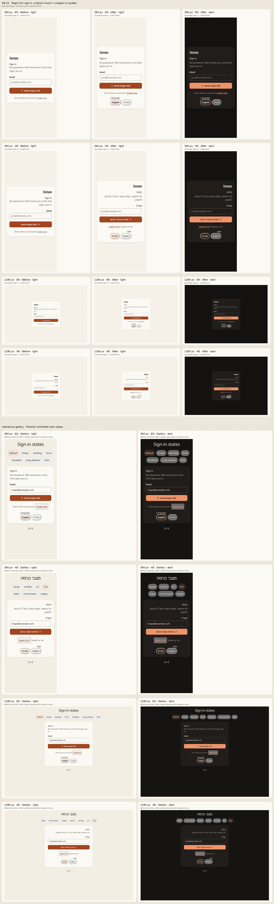

# KB-10 · Sign-in stays clear while a magic link is on its way

Source: `origin/integration` at `52bf2803e9105b25c2538aedd81a754a9fbfdedb`. The before captures bundle the saved, checked-in `SignInForm` page mount (SHA-256 `3c621c5562329b97674acb64446630d8cf58becf7c3326f26e526c058e8c1f99` matches the integration file); after captures bundle the scoped mounted component with an injected fictional auth callback. The original was frozen before editing; its browser capture ran later under the shared validation lock. Neither uses a real account or sends an email. The fixture uses the repository's v3 styles and `TpIcon` sprite, replacing only the auth action, locale context and Next link adapter. Hebrew copy is machine-drafted for Amit's native review.



The contact sheet labels 390/1280 px, English/Hebrew, the initial form state and before/after light views, plus the after dark view. The original page did not localize its content in Hebrew, which the before capture shows. Dark styling is compared only within the after branch.

## Browser and keyboard findings

- `MagicLinkStatus` and `SignInHelp` are mounted through the existing `SignInForm` on `/sign-in`, with the same `SignInFormProps` and the same `signIn("resend", { email, ...(nextPath ? { redirectTo: nextPath } : {}) })` call. The modal and sign-up wrapper also use this form. `Kb10Gallery` uses the real views with fictional controlled props and callbacks.
- Tests cover initial form, invalid email and associated error, duplicate-send blocking, sent heading focus and LTR email, server-send error with retained input, keyboard reset focus, Hebrew RTL and LTR email, 44 px phone targets and overflow, sign-up/modal callback compatibility, gallery states, visible focus and reduced motion.
- The gallery exposes default, empty, pending, error, disabled, overflow and sent controls. Gallery screenshots from all width/locale/theme combinations are captured to the local test output and included below the mounted before/after views in the contact sheet.
- Browser checks require one main and one h1 in the standalone fixture, keyboard-reachable controls and `document.documentElement.scrollWidth <= innerWidth` at 390 and 1280 px.
- The outer `SignInModal` and `SignUpModal` DialogTitle copy remains English when the nested form switches to Hebrew; those wrappers are outside this ticket. Live email delivery, backend state and device screen readers remain **UNKNOWN**.

## Test results (cloud agent sandbox)

Bun: **1.3.9**. Frozen-original baseline capture exited 0 for 390/1280 px in English and Hebrew; each capture contained one mounted `main`.

| Command | Exit | Result |
|---|---:|---|
| `bun --version` | 0 | 1.3.9 |
| `bun install --frozen-lockfile` | 0 | Checked 1033 installs across 1079 packages, no changes |
| `bun run lint` | 0 | 5/5 tasks, 0 errors; pre-existing warnings in unrelated files |
| `bun run typecheck` | 0 | 5/5 tasks successful |
| `bun run test` | 0 | 3314 pass, 3 todo, 0 fail across 3317 tests / 202 files; all 13 KB-10 cases passed |
| `bun run scan:forbidden-tech && bun run scan:ram-only-audit && bun run scan:design-tokens && bun run check:notices` | 0 | All four OK |
| `CI=1 bunx playwright test --reporter=line` | 1 | 27 passed, 89 skipped, 1 unrelated task-views-core failure in 4.7m; no sign-in test failed |
| `NEXT_PUBLIC_CONVEX_URL=https://example.convex.cloud bun run build` | 0 | 1/1 task successful; web production build and TypeScript completed in 1m51.867s; wrapper exited 0 after cache packaging |

The 13 regression cases in `tests/unit/kb-10.test.tsx` passed locally (13 pass, 0 fail, 95 assertions), including the 390/1280 en/he light/dark screenshots. Their names are: initial form offers one email field and one primary send action; invalid email stays local, has associated error and keeps input focus; pending disables duplicate send without changing resend arguments; sent status focuses its heading and isolates the address; send error retains the entered address and exposes a retry; keyboard reset returns focus to the retained email; Hebrew switch uses RTL while email remains LTR; phone controls meet 44 px and long address cannot widen the page; sign-up and modal preserve shared callbacks and approval copy; gallery controls change real states, send and reset; reduced motion and keyboard focus remain visible; new exports render and English/Hebrew keys match; mounted and gallery screenshots cover 390/1280, en/he, light/dark. CI on source commit `87cc05a` passed Test, Lint, Typecheck, Build, E2E, preview E2E, scans and aggregate `ci`. Earlier source commit: `ef60219`.

Local Playwright failure excerpt (last relevant lines):

```text
1) [chromium] › tests/e2e/task-views-core.spec.ts:14:7 › core task views
Test timeout of 30000ms exceeded.
Error: locator.click: Test timeout of 30000ms exceeded.
  waiting for getByRole('button', { name: 'Edit Pay the power bill' })
  at tests/e2e/task-views-core.spec.ts:33:67
1 failed · 89 skipped · 27 passed (4.7m)
```

Last 20 lines of local Playwright output:

```text
[108/117] [chromium] › tests/e2e/wiring/settings-nags-memory.spec.ts:7:7 › settings nags + memory wiring › /settings/nags renders the nags screen and nav links exist
[109/117] [chromium] › tests/e2e/wiring/settings-account.spec.ts:16:9 › settings + account wiring › /billing mounts its component
[110/117] [chromium] › tests/e2e/wiring/settings-nags-memory.spec.ts:15:7 › settings nags + memory wiring › /settings/memory renders the memory screen
[111/117] [chromium] › tests/e2e/wiring/templates-onboarding.spec.ts:26:9 › templates and onboarding wiring › /templates mounts its component
[112/117] [chromium] › tests/e2e/wiring/today.spec.ts:10:7 › today wiring › /today mounts habit check-in and day plan markers
[113/117] [chromium] › tests/e2e/wiring/templates-onboarding.spec.ts:26:9 › templates and onboarding wiring › /templates/builder mounts its component
[114/117] [chromium] › tests/e2e/wiring/templates-onboarding.spec.ts:26:9 › templates and onboarding wiring › /templates/builder?from=<id> mounts its component
[115/117] [chromium] › tests/e2e/wiring/templates-onboarding.spec.ts:26:9 › templates and onboarding wiring › /templates/editor/[id] mounts its component
[WebServer] (node:80281) Warning: The 'NO_COLOR' env is ignored due to the 'FORCE_COLOR' env being set.
[WebServer] (Use `node --trace-warnings ...` to show where the warning was created)

[116/117] [chromium] › tests/e2e/wiring/templates-onboarding.spec.ts:26:9 › templates and onboarding wiring › /templates/run/[id] mounts its component
[WebServer] (node:80333) Warning: The 'NO_COLOR' env is ignored due to the 'FORCE_COLOR' env being set.
[WebServer] (Use `node --trace-warnings ...` to show where the warning was created)

[117/117] [chromium] › tests/e2e/wiring/templates-onboarding.spec.ts:26:9 › templates and onboarding wiring › /onboarding mounts its component
  1 failed
    [chromium] › tests/e2e/task-views-core.spec.ts:14:7 › core task views › today, inbox, project, priority, and energy views share one persisted task record
  89 skipped
  27 passed (4.7m)
```
