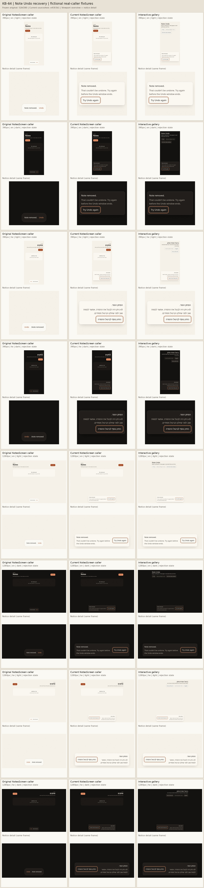

# KB-64 — safe note Undo recovery

**Status: stuck.** Three source/test repair candidates have been used. Required local failures remain material even when remote CI is green; there will be no fourth repair. The PR body records the evidence/current head and its remote CI snapshot.

A rejected or synchronously thrown note Undo now stays contained in the existing notice, shows a short localized explanation and offers explicit retry within its original absolute deadline. The notice guards duplicate activation, waits for an accepted request to settle before expiring, and leaves successful parent removal/navigation authoritative. Fulfillment alone produces no invented success message.



## Provenance and scope

- Original integration source: `52bf2803e9105b25c2538aedd81a754a9fbfdedb`; frozen `UndoDeleteToast.tsx` SHA-256: `7923087e19150c3c32bc14faccf735cecb4b6f9b0b64481315c68f1c558db94f`. It was frozen before any scoped edit, and all eight original caller captures and rejection observations completed before applying the implementation.
- Prior evidence head `18ab10e5582fb49b47e878d5a55947f9512ecabc`: remote checks green (including ci, e2e-preview, secret-scan, config-guard and scope-guard). The PR body records the final evidence head and current-head check snapshot; green remote results do not override the local required failures below.
- Final source/test commit: `e4303b195cd6dff4ffa0cbdb7a2bf41a8a9175d5`. This is **attempt 3 of 3**. The implementation is unchanged from `4b39f86`; the final test-only candidate scopes the late-success assertion to this toast and discovers already-installed Chromium/Chrome. The cancelled pre-start wrapper had a zero-byte test log and exit 143; no test process started, so it was not another failed run.
- Both original and current fixtures import the real unchanged `NotesScreen`, including its real detail editor tree. They stub only query/mutation/auth, Next navigation, locale transport and generated API boundaries. Both list and detail restore callbacks are exercised unchanged; their owners #1053/#1081 remain read-only. The styles are the actual globals/v3 CSS compiled through installed PostCSS/Tailwind, plus the scoped ticket CSS.
- Browser: system Chromium 151 on Linux; Bun 1.3.9. The ticket-authorized isolated Playwright fixture is used because no callable Browser automation tool is available here. All browser work uses loopback and fictional Maya/Dana/Yoni data, with no live account or backend write.
- Font/capture limitation: these fixtures serve compiled CSS and bundle assets but do not serve the local `/fonts/*` URLs referenced by globals.css. Those requests receive 404 and the browser uses system fallbacks, even though the font files exist in this checkout. The harness records pageerror/unhandled rejection; it does not collect every console/resource error. The captures and wrapping checks therefore do not establish production-font geometry or a completely clean console.
- The contact sheet contains eight original caller, eight current caller and eight gallery frames: 390/1280 px, English/Hebrew, light/dark. Each tile shows a viewport overview and a crop of the same frame's notice for readable detail. Labels are evidence annotations only. The repaired production notice adds no main/h1; caller and gallery each own exactly one of each. This ticket adds **zero primary views**.

## Original proof and corrected behavior

The original-proof case passed **1/1, 16 assertions**, because it deliberately verifies the existing defect: each of the eight real list-caller frames emitted exactly one synthetic `PRIVATE_BACKEND_DETAIL` unhandled rejection/pageerror, offered no safe retry and retained hardcoded English toast copy on Hebrew screens. This was a passing proof of the original bug, not a red implementation test.

Current scoped run: **27 pass, 0 fail, 178 assertions**, exit **0**. The final file contains 27 named cases, including both real caller branches, keyboard-only Tab traversal to the re-enabled Retry and Enter activation, visible focus, exact deadline boundaries, same-tick duplicates, StrictMode, unmount/changed-deadline cleanup, retry without extension, and false fulfillment without a success claim. The matrix checks caller/gallery landmarks, 44 px Undo controls, no horizontal overflow and all eight language/theme/width combinations. Large-text checking asserts a rendered 32 px size, wrapping and the unchanged global reduced-motion upper bound 0.0000101 s (0.0101 ms); normal mode is compared when it has an actual nonzero transition.

The first local candidate introduced a late-success expiry race: an accepted detail Undo fulfilled after the deadline, but immediate child expiry navigated to `/notes` before the successful parent's `/notes/maya-note` restoration could remain authoritative. The unchanged detail caller reproduced this at the transport boundary:

```text
Before late success {"url":"http://127.0.0.1:39117/notes","busy":"true"}
After late success {"url":"http://127.0.0.1:39117/notes","body":"not found","incorrectExpiryNavigation":true}
```

The loopback server only serves the fixture root, so its `not found` body identifies that unexpected document navigation; it is not a claim that the real app's `/notes` route is missing. The correction checks expiry in the post-commit feedback effect. The final regression requires the real PageEditor to return, the toast to detach, and the restored-note URL to remain `/notes/maya-note`. A fresh feedback object also makes an immediate fulfilled callback observable even if busy/idle updates batch into one commit; the synchronous pending ref still clears and every activation checks Date.now.

## API limits and remaining verification

`isUndoActive(number,number)`, `onUndo():Promise<void>` and `onExpire():void` are unchanged. Retry never resets the server-supplied deadline. A fulfilled parent callback can have swallowed `success:false`, so the child cannot infer a restoration receipt. Receipt replacement with the exact same deadline cannot reliably be distinguished through this API; callback reference changes are deliberately not treated as identity. Unmount/changed-deadline cleanup fences the child's feedback/expiry, while underlying callback/backend work remains owned by the caller.

Authenticated/deployed restoration and data, device VoiceOver/TalkBack, and native Hebrew copy review remain UNKNOWN. Hebrew is machine-drafted in source for Amit's native read. The broader KB-64 notes/pages family remains residual work; no caller, route, backend, environment, dependency, configuration, CI or scan baseline changed.

## Test results (cloud agent sandbox)

Status: **stuck** after all three source/test repair attempts. The unchanged full-unit performance and task-view E2E failures remain required failures despite the scoped 27/27 pass and green remote CI.

Bun **1.3.9**. Dependency bootstrap followed a frozen-install resolution timeout: all seven root/workspace manifests and bun.lock matched KB75 byte-for-byte before copying all six ignored node_modules trees. No Turbo archives were copied. A fresh exact frozen install after this environment repair is included below. Build uses only tool-side `TURBO_CACHE=local:r`; validation owns the outer lock, full unit also owns fixture.lock, and E2E/build use their inner locks.

| Command | Exit | Counts/result |
|---|---:|---|
| `bun --version` | 0 | PASS: 1.3.9 |
| `bun install --frozen-lockfile` | 124 | UNKNOWN: dependency resolution stalled; 120-second timeout |
| `bun run lint` | 0 | PASS: 5/5 tasks; 0 errors, 9 existing warnings |
| `bun run typecheck` | 0 | PASS: 5/5 tasks |
| `bun run test` | 1 | FAIL: 3327 pass, 3 todo, 1 fail, 0 errors; 81196 assertions |
| `bun run scan:forbidden-tech && bun run scan:ram-only-audit && bun run scan:design-tokens && bun run check:notices` | 0 | PASS: four OK checks |
| `CI=1 bunx playwright test --reporter=line` | 1 | FAIL: 27 pass, 89 skipped, 1 fail |
| `NEXT_PUBLIC_CONVEX_URL=https://example.convex.cloud bun run build` | 0 | PASS: 1/1 tasks |

## Check history and failure evidence

- Initial baseline harness: 0 pass/1 startup failure before any browser opened, because the frozen copy under ignored work/before could not resolve React. An ignored dependency symlink to the unchanged web node_modules fixed that environment setup; the unchanged original then passed its defect-proof case.
- First scoped candidate `28b0583`: 24 pass, 1 fail, 171 assertions. The new test incorrectly required exactly 0 s transition duration; the real unchanged global reduced-motion policy measured 0.00001 s (0.01 ms). Production global CSS was not changed.
- Second scoped candidate `4b39f86`: 21 pass, 6 fail, 1 error. The late-success correction had already returned the real PageEditor, but the new test waited for every output element to detach and matched the editor's unrelated hidden save-status output. Its 30 s timeout caused Bun to kill browser processes, producing five subsequent browser-closure cascades. The final assertion targets only `.kb64-toast` while retaining the restored URL and real-editor checks.
- First formal build started at 02:28:35 UTC; its 616-byte log last changed at 02:30:03 UTC after successful compilation and `Running TypeScript`. At 03:26:19 UTC, no live build/wrapper/lock owner or retained exit remained. This is **UNKNOWN: interrupted during the environment/session interval**, not a pass or a source failure. The original log/start metadata is retained; only this unfinished build is rerun at the same frozen source/test with validation/build locks, tool-side `TURBO_CACHE=local:r` and a 900-second process bound plus 30-second termination grace. All completed tests/checks remain untouched. The replacement build completed naturally with exit 0, 1/1 task, 2m11.175s; no termination was needed.
- Final candidate `e4303b1` is frozen; there will be no fourth source/test repair.

Initial frozen install timeout (UNKNOWN environment resolution), last 20 available lines:
```text
bun install v1.3.9 (cf6cdbbb)
Resolving dependencies
```

Initial baseline fixture setup, last 20 available lines:
```text
    at /workspace/work/kb-64/work/before/UndoDeleteToast.tsx:3:37

error: Could not resolve: "react/jsx-dev-runtime". Maybe you need to "bun install"?
    at /workspace/work/kb-64/work/before/UndoDeleteToast.tsx

Bun v1.3.9 (Linux x64)
108 |     dir = mkdtempSync(join(repo, "work/kb64-fixture-"));
109 |     child = Bun.spawn([process.execPath, resolve(repo, "tests/unit/kb-64.test.tsx")], { cwd: repo, env: { ...process.env, KB64_CHILD: "1", KB64_DIR: dir }, stdout: "ignore", stderr: "inherit" });
110 |     let exited = false;
111 |     void child.exited.then(() => { exited = true; });
112 |     for (let n = 0; n < 900 && !existsSync(join(dir, "port")) && !exited; n++) await Bun.sleep(100);
113 |     if (!existsSync(join(dir, "port"))) throw new Error(`KB64 fixture failed to start (child exited=${exited})`);
                                                        ^
error: KB64 fixture failed to start (child exited=true)
      at <anonymous> (/workspace/work/kb-64/tests/unit/kb-64.test.tsx:113:51)
(fail) (unnamed) [1987.91ms]

 0 pass
 1 fail
Ran 1 test across 1 file. [3.05s]
```

First scoped candidate, last 20 available lines:
```text
561 |         ).toBe("none");
562 |         expect(
563 |           await page.locator("output").evaluate((el) => getComputedStyle(el).transitionDuration)
564 |         ).toBe("0s");
                ^
error: expect(received).toBe(expected)

Expected: "0s"
Received: "1e-05s"

      at <anonymous> (/workspace/work/kb-64/tests/unit/kb-64.test.tsx:564:11)
(fail) KB64 Undo recovery > large text wraps and reduced motion has no toast animation [1924.12ms]

1 tests failed:
(fail) KB64 Undo recovery > large text wraps and reduced motion has no toast animation [1924.12ms]

 24 pass
 1 fail
 171 expect() calls
Ran 25 tests across 1 file. [144.80s]
```

Second scoped candidate, last 20 available lines:
```text
 log: [],

      at open (/workspace/work/kb-64/tests/unit/kb-64.test.tsx:140:32)
      at /workspace/work/kb-64/tests/unit/kb-64.test.tsx:570:28
(fail) KB64 Undo recovery > large text wraps and reduced motion has no toast animation [136.87ms]

6 tests failed:
(fail) KB64 Undo recovery > late successful real detail restoration keeps the parent navigation authoritative [30004.68ms]
  ^ this test timed out after 30000ms.
(fail) KB64 Undo recovery > real NotesScreen list callback contains rejection and retries the same note [289.43ms]
(fail) KB64 Undo recovery > real NotesScreen page callback contains rejection and leaves false fulfillment neutral [66.27ms]
(fail) KB64 Undo recovery > gallery reuses the notice and supports reject retry expiration and language [35.75ms]
(fail) KB64 Undo recovery > real caller and gallery fit both widths languages and themes with 44px controls [147.37ms]
(fail) KB64 Undo recovery > large text wraps and reduced motion has no toast animation [136.87ms]

 21 pass
 6 fail
 1 error
 49 expect() calls
Ran 27 tests across 1 file. [67.84s]
```

Interrupted formal build (no retained exit; UNKNOWN), last 20 available lines:
```text
$ turbo run build
• turbo 2.9.6

   • Packages in scope: @tempo/config, @tempo/types, @tempo/ui, @tempo/utils, tempo-rhythm-mobile, tempo-rhythm-web
   • Running build in 6 packages
   • Remote caching disabled, using shared worktree cache

tempo-rhythm-web:build: cache miss, executing ef6e2100f414ec8a
tempo-rhythm-web:build: $ next build --turbopack
tempo-rhythm-web:build: ▲ Next.js 16.2.4 (Turbopack)
tempo-rhythm-web:build:
tempo-rhythm-web:build:   Creating an optimized production build ...
tempo-rhythm-web:build: ✓ Compiled successfully in 82s
tempo-rhythm-web:build:   Running TypeScript ...
```

`install` (exit 124), last 20 available lines:
```text
bun install v1.3.9 (cf6cdbbb)
Resolving dependencies
```

`test-full` (exit 1), last 20 available lines:
```text
(pass) json-render 0.21.0 behaviour that makes validateBlockSpec necessary > catalog.validate() drops bindings, so it cannot vet actions [0.42ms]
(pass) json-render 0.21.0 behaviour that makes validateBlockSpec necessary > it does reject an element type outside the catalog [0.27ms]
(pass) module boundary > imports only the pinned json-render entry points, the shared codec, zod and the catalog [0.21ms]
(pass) module boundary > does not load React, a renderer, state adapters, storage or the network [0.31ms]

3 tests todo:
(todo) Agent component under Bun: unresolved coverage > scheduler-driven deletion (deleteAllForThreadIdAsync) under Bun fake timers
(todo) Agent component under Bun: unresolved coverage > streaming deltas, abort and timeout cleanup (streams.*)
(todo) Agent component under Bun: unresolved coverage > vector and text search over saved messages


1 tests failed:
(fail) pathological bodies stay linear > closingTagsOpenOnEveryLine [3357.75ms]

 3327 pass
 3 todo
 1 fail
 81196 expect() calls
Ran 3331 tests across 202 files. [154.38s]
error: script "test" exited with code 1
```

`e2e` (exit 1), last 20 available lines:
```text
[108/117] [chromium] › tests/e2e/wiring/settings-nags-memory.spec.ts:15:7 › settings nags + memory wiring › /settings/memory renders the memory screen
[109/117] [chromium] › tests/e2e/wiring/settings-account.spec.ts:16:9 › settings + account wiring › /notifications mounts its component
[110/117] [chromium] › tests/e2e/wiring/templates-onboarding.spec.ts:26:9 › templates and onboarding wiring › /templates mounts its component
[111/117] [chromium] › tests/e2e/wiring/settings-account.spec.ts:16:9 › settings + account wiring › /billing mounts its component
[112/117] [chromium] › tests/e2e/wiring/templates-onboarding.spec.ts:26:9 › templates and onboarding wiring › /templates/builder mounts its component
[113/117] [chromium] › tests/e2e/wiring/today.spec.ts:10:7 › today wiring › /today mounts habit check-in and day plan markers
[114/117] [chromium] › tests/e2e/wiring/templates-onboarding.spec.ts:26:9 › templates and onboarding wiring › /templates/builder?from=<id> mounts its component
[115/117] [chromium] › tests/e2e/wiring/templates-onboarding.spec.ts:26:9 › templates and onboarding wiring › /templates/editor/[id] mounts its component
[WebServer] (node:230422) Warning: The 'NO_COLOR' env is ignored due to the 'FORCE_COLOR' env being set.
[WebServer] (Use `node --trace-warnings ...` to show where the warning was created)

[116/117] [chromium] › tests/e2e/wiring/templates-onboarding.spec.ts:26:9 › templates and onboarding wiring › /templates/run/[id] mounts its component
[WebServer] (node:230617) Warning: The 'NO_COLOR' env is ignored due to the 'FORCE_COLOR' env being set.
[WebServer] (Use `node --trace-warnings ...` to show where the warning was created)

[117/117] [chromium] › tests/e2e/wiring/templates-onboarding.spec.ts:26:9 › templates and onboarding wiring › /onboarding mounts its component
  1 failed
    [chromium] › tests/e2e/task-views-core.spec.ts:14:7 › core task views › today, inbox, project, priority, and energy views share one persisted task record
  89 skipped
  27 passed (4.1m)
```

Full-unit failure context: unchanged `packages/utils/src/page-summary.test.ts:1204`, `closingTagsOpenOnEveryLine`, required < 3000 ms; measured 3353.6623449999897 ms. All 27 scoped KB64 cases passed within that full run. This required failure remains material even with green remote CI; no fourth repair or broad repeat.

E2E failure context: unchanged `tests/e2e/task-views-core.spec.ts:50`, core task views, 30-second test timeout while `page.goto("/tasks/energy")` waited for load; `net::ERR_ABORTED`. Screenshot, error-context Markdown and trace were retained under ignored `test-results/task-views-core-core-task--ccb5c-e-one-persisted-task-record-chromium/`.

## Named scoped cases

- isUndoActive keeps the existing strict deadline boundary
- English and machine-drafted Hebrew have matching typed keys
- a rejected callback shows safe recovery without an unhandled rejection
- raw backend detail is never rendered in the notice
- a synchronously thrown callback also returns a safe retry
- pointer retry calls once more and keeps the original deadline
- keyboard retry is reachable and has a visible focus ring
- same-tick duplicate activation starts one callback
- activation at the deadline cannot start a callback even before its timer fires
- activation after the deadline is also refused
- normal expiry runs once through StrictMode and callback re-renders
- expiry during a pending request waits for fulfillment then expires once
- rejection after pending expiry expires without offering a fresh retry
- retry does not restart the expiry timer
- fulfillment makes no invented success claim and does not expire early
- unmount fences a stale rejected request and cancels expiry
- changed deadline fences an old rejection without leaking error or busy state
- changed deadline fences an old fulfilled request after the old deadline
- new inline callback identities do not reset an active request
- Hebrew recovery has RTL direction and localized action copy
- an immediate fulfillment crossing the deadline still schedules post-commit expiry
- late successful real detail restoration keeps the parent navigation authoritative
- real NotesScreen list callback contains rejection and retries the same note
- real NotesScreen page callback contains rejection and leaves false fulfillment neutral
- gallery reuses the notice and supports reject retry expiration and language
- real caller and gallery fit both widths languages and themes with 44px controls
- large text wraps and reduced motion has no toast animation
