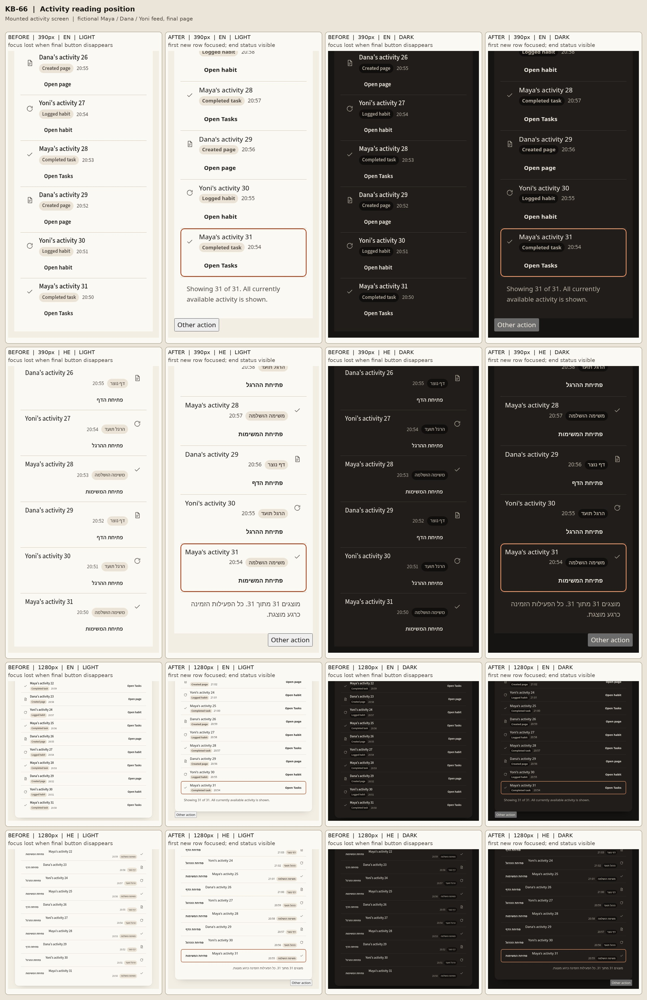

# KB-66 — activity load more keeps the reader's place

The mounted `/activity` screen now keeps keyboard readers on the first row revealed by Show older. After the final click removes that button, the focused new row remains in the list and a quiet message says that all **currently available** activity is shown. The existing query returns at most 50 recent records, so this message does not claim to cover all historical activity. The current seven-day grouping, row destinations and exact query calls are unchanged.



## Capture method and limits

The **before** images use the exact original mounted `ActivityScreen.tsx` source, frozen before any scoped edit in ignored `work/before/ActivityScreen.tsx` (SHA-256 `21dd14aea1e40b703b64039fca24326c5c4a6702441f567e72967f607f4d20d8`). An isolated browser fixture imports that frozen production component with fictional Maya, Dana and Yoni rows and mocked `activity.list`/profile responses. The browser capture itself ran later in the shared validation queue, after code editing began; its import stays pinned to the original source. It exercised the two Show older clicks that remove the final button; `document.activeElement` was then `<body>` in all eight before frames. These are production-component fixture captures, not authenticated `/activity` route captures.

The **after** images use the changed mounted `ActivityScreen` in the same kind of isolated hydrated fixture, with the same fictional 31-item feed. The contact sheet compares the bottom of the list after the final click at 390 and 1280 px, English and Hebrew, light and dark. The visible `Other action` button is a fixture-only control used to test focus moved elsewhere. An interactive `Kb66Gallery` also imports the same `ActivityLoadMore`, `ActivityEndStatus` and row views used by production. No real account data appears.

## Browser findings

- Show older reveals 10 more items per press; 21 and 30 items end after one press, 31 after two, and exactly 20 shows the end message immediately.
- Keyboard activation focuses the first newly revealed row, including after the final button disappears. That row has `tabIndex=-1`, so it adds no extra Tab stop. Moving focus to another control during the update is respected.
- A reactive new row does not itself move focus; subsequent paging uses the last visible row as its boundary. StrictMode does not duplicate the live count.
- Count and time text remain left-to-right inside Hebrew direction. The fixture checks one `main`/`h1`, 44 px targets, visible keyboard focus, reduced motion, large text, and no horizontal viewport overflow.

The unchanged authenticated `/activity` E2E spec requires `TEMPO_E2E_STORAGE_STATE` and skips without it. Authenticated data, the backend snapshot beyond its 50-item cap, device VoiceOver/TalkBack and native Hebrew copy review remain **UNKNOWN** in this sandbox. Hebrew strings are machine-drafted for Amit's native read.


## Review repair and sandbox diagnostics

Review-repair source and test commit: `fa0599e763ff1d9b6d7dccc30e1695b90e751464`. This follow-up is locally tested; it does not claim deployment or authenticated backend verification.

- **AT — 4335159709:** A pending Show older click now records the last visible row's `occurredAt` value. If that row disappears from the reactive snapshot, fallback focus considers only unseen rows at or before that ordering boundary. The existing anchor-present search remains intact. The new case, `pending load keeps its older boundary when the anchor disappears beside a new top row`, changes the query during the same click, removes `a19`, inserts a newer row at the top, and verifies focus on older `a20` in English and Hebrew under StrictMode. The preceding product source failed this regression while all 18 existing cases passed.
- **AT — 4335159718:** Screenshot outputs now live inside the fixture's unique temporary directory and are removed by the existing `afterAll` cleanup. Both the failing and passing child runs left zero `kb66-gallery-*` fixture directories. **AWAY — ignore-file edit:** `git check-ignore -v work/kb66-mounted-final-390-en-light.png` confirms the checkout's shared `.git/info/exclude` already ignores `/work/`. Cleanup also prevents this test's screenshots from remaining untracked in a fresh checkout. No out-of-scope `.gitignore` edit was needed.
- **AT — fixture isolation:** Normal test execution runs all 19 actual cases in one clean Bun child process, preserving every original assertion and individual timeout. The parent registers the same named cases, rejects every nonzero child exit, and retains the child's output. Even when a parent name filter selects fewer reports, the child executes its entire suite. The actual component import, `Bun.build`, `Bun.serve` and browser instance stay in that clean process. The failed child status was observed and propagated during the regression proof. Combined full-suite behavior remains pending root-owned validation.

Bun 1.3.9 and installed Chromium were used. The following are focused/light diagnostics, not a claim that the complete ordered AGENTS.md gate sequence has finished.

| Command | Exit | Results |
| --- | --- | --- |
| `bun --version` | 0 | `1.3.9` |
| `bun test tests/unit/kb-66.test.tsx -t 'anchor disappears'` before the product fix | 1 | Clean child: 18 pass, 1 fail, 32 Bun assertions; parent: 1 fail, 18 filtered reports. Expected focus regression; 77.72 seconds total. |
| `bun test tests/unit/kb-66.test.tsx` after the product fix | 0 | Clean child: 19 pass, 0 fail, 32 Bun assertions plus the retained Playwright checks, 90.67 seconds. Parent: 19 pass, 0 fail, 19 report assertions, 93.64 seconds total. These are the same 19 cases, not 38 independent cases. |
| `bun run lint` | 0 | 5 successful tasks / 5 total; 0 errors, 10 warnings in untouched files. |
| `bun run typecheck` | 0 | 5 successful tasks / 5 total; 1m13.786s. |
| `bun run scan:forbidden-tech && bun run scan:ram-only-audit && bun run scan:design-tokens && bun run check:notices` | 0 | All four checks OK. |
| `bun install --frozen-lockfile` | UNKNOWN | Pending root-owned ordered validation. |
| `bun run test` | UNKNOWN | Full standard suite pending root-owned validation. |
| `CI=1 bunx playwright test --reporter=line` | UNKNOWN | Full E2E run pending root-owned validation. |
| `NEXT_PUBLIC_CONVEX_URL=https://example.convex.cloud bun run build` | UNKNOWN | Build pending root-owned validation. |

The complete diagnostic logs are retained under `/workspace/work/kb-finish/kb66/`: `anchor-before.log`, `focused-after.log`, `version.log`, `lint.log`, `typecheck.log` and `scans.log`. Final checks after the integration rebase belong to root. No test skip, assertion removal, timeout extension, scan-baseline or configuration change was used.

Last 20 lines of the expected failing regression run:

```text
      at captureRawStack (/workspace/work/kb-66/node_modules/.bun/playwright-core@1.62.1/node_modules/playwright-core/lib/coreBundle.js:9681:21)
      at callMatcherAsStep (/workspace/work/kb-66/node_modules/.bun/playwright@1.62.1/node_modules/playwright/lib/matchers/expect.js:13310:57)
      at /workspace/work/kb-66/tests/unit/kb-66.test.tsx:194:32
      at processTicksAndRejections (native:7:39)
(fail) KB-66 hydrated activity gallery and mounted screen > pending load keeps its older boundary when the anchor disappears beside a new top row [10277.06ms]
(pass) KB-66 hydrated activity gallery and mounted screen > gallery controls and retry callback remain operable [4121.39ms]
(pass) KB-66 hydrated activity gallery and mounted screen > mounted production view and gallery fit phone and desktop in both languages and themes [29016.04ms]

 18 pass
 1 fail
 32 expect() calls
Ran 19 tests across 1 file. [73.95s]

      at <anonymous> (/workspace/work/kb-66/tests/unit/kb-66.test.tsx:38:39)
(fail) pending load keeps its older boundary when the anchor disappears beside a new top row [74019.87ms]

 0 pass
 18 filtered out
 1 fail
Ran 1 test across 1 file. [77.72s]
```
