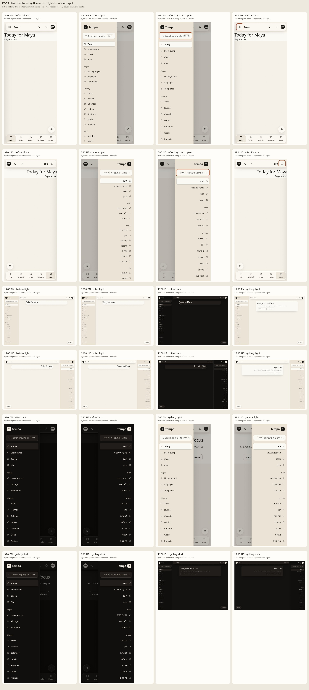

# KB-74 · Mobile navigation drawer keeps keyboard focus in view

Source baseline: `origin/integration` at `52bf2803e9105b25c2538aedd81a754a9fbfdedb`. Before captures bundle the verbatim original `TempoShell.tsx` saved before the first host edit (SHA-256 `bb2473d1e21cfca0e80fd164906307656d5fc39a9c7b076474457abd57a82782` matches that integration file), with unchanged real Sidebar, Topbar, TabBar, coach and palette children. After captures bundle the scoped production TempoShell and the same real children. Both branches compile the repository global stylesheet through its installed PostCSS/Tailwind plugin, as the production build does. The original was frozen before editing; its browser capture ran later under the fixture lock and exited 0 for 390/1280 px English/Hebrew. Both use fictional Maya profile data and stubbed query/auth/navigation transport; no real account or backend write is exercised. Hebrew copy is machine-drafted for Amit's native review.



The contact sheet labels 390/1280 px, English/Hebrew, light before/after, after dark, original open drawer, keyboard-open after state with visible focus, restored-focus state, and the real interactive gallery. The original open drawer can leave focus on its topbar trigger; after the repair the first actionable Sidebar control receives focus. No production route or child module was added.

## Browser and keyboard findings

- `TempoShell` remains the single mounted owner in the signed-in `(tempo)` layout. Its actual topbar and tabbar triggers open the real Sidebar drawer. The active-at-open guard avoids stealing focus after the user moves elsewhere; closing returns to the remembered visible trigger only while focus remains in the drawer or scrim.
- While the narrow drawer is modal, background shell children are inert and Tab / Shift+Tab wrap between visible Sidebar controls. Escape and scrim click dismiss. Following a Sidebar link focuses the existing main, including the same route; resizing to desktop releases modal inert and trapping without forcing focus to a hidden menu.
- The real command palette and coach sheet supersede the drawer with their own focus and Escape ownership. The gallery reuses the mounted shell, locale/theme controls and actual overlays, with fictional data.
- Tests include programmatic button clicks while another control retains focus, StrictMode replay, RTL, phone targets of at least 44 px, computed v3 CSS, no horizontal overflow, reduced motion and browser pageerror collection.
- A local fixture cannot establish a live authenticated shell or device screen-reader behavior; those remain **UNKNOWN**.

The 25 named browser and regression cases are:

- local copy has English/Hebrew key parity
- fixture hydrates the real three navigation children with v3 CSS
- topbar opener moves focus into the real Sidebar
- tabbar opener moves focus into the real Sidebar
- keyboard opening shows visible focus inside the real drawer
- programmatic topbar click remembers its real trigger while another button had focus
- programmatic tabbar click returns to tabbar rather than the previously focused control
- forward Tab wraps from the last drawer control to its first
- reverse Tab wraps from the first drawer control to its last
- background main, topbar and tabbar are inert while the drawer is modal
- Escape closes the drawer and restores its visible topbar opener
- scrim click closes and restores a valid opener
- dismissal does not steal focus the reader moved outside the shell
- following a Sidebar link closes drawer and focuses the existing main
- same-route Sidebar link closes drawer and focuses main
- real command palette supersedes the drawer without returning to an inert rail
- Ctrl K supersedes the open drawer and Escape closes only the palette
- real coach sheet supersedes the drawer and returns to its coach button
- resizing to desktop releases inert and drawer Tab containment
- desktop static rail stays accessible without modal trapping
- StrictMode reopen still focuses the drawer after dismissal
- Hebrew RTL drawer opens on the leading edge and restores focus
- gallery language and theme controls update the real shell
- mounted shell and gallery fit both languages, themes and widths
- reduced motion uses the existing near-zero CSS policy

## Test results (cloud agent sandbox)

Bun: **1.3.9**. Final source/test commit: `62c85a6`; earlier source/test commits: `86e7a97`, `3e97fde`. Formal local gates have finished: status **stuck**, source/test attempt 3 of 3 exhausted. Local full-test and E2E failures remain despite green remote CI.

| Command | Exit | Result |
| --- | ---: | --- |
| `bun --version` | 0 | PASS: 1.3.9 |
| `bun install --frozen-lockfile` | 0 | PASS: frozen install, no lock change; 1,079 packages |
| `bun run lint` | 0 | PASS: 5/5 tasks, 0 errors; existing warnings |
| `bun run typecheck` | 0 | PASS: 5 successful, 5 total |
| `bun run test` | 1 | FAIL: 3324 pass, 3 todo, 2 fail |
| `bun run scan:forbidden-tech && bun run scan:ram-only-audit && bun run scan:design-tokens && bun run check:notices` | 0 | PASS: four OK checks (also green on remote evidence head) |
| `CI=1 bunx playwright test --reporter=line` | 1 | FAIL: 25 pass, 89 skipped, 3 fail |
| `NEXT_PUBLIC_CONVEX_URL=https://example.convex.cloud bun run build` | 0 | PASS: 1 successful, 1 total |

Initial CI on `3e97fde` passed Lint, Typecheck, Build, E2E, scans, and scope/config guards. Its Test job reported **3301 pass, 3 todo, 1 fail**: the fixture child bundle returned extensionless absolute paths for `@/` aliases and omitted a fictional `useConvex` stub needed by the real coach hook. The corrected fixture passed a bundle-only smoke and the complete hydrated browser run locally, then was pushed at `62c85a6`. Remote Test, E2E, Build, lint, typecheck, scans, notices and required checks passed on evidence head `ec45bc3`, with the same source/tests. This does not replace the failed local mandatory checks. The initial CI failure is a fixture failure, not a product-shell regression result.

The first hydrated fixture run reached all 25 cases: 24 passed and one focus-ring assertion failed because the fixture served raw `globals.css`. Its Tailwind `@theme` ring token was unresolved in a standalone browser; the focused control matched `:focus-visible` but showed no outline or box shadow. Both fixture branches now compile the actual global stylesheet through installed PostCSS/Tailwind. On the final fixture, all 25 cases pass; in English and Hebrew the focused Sidebar control has a computed 2 px accent outline. No product CSS override was needed. Frozen-original open-drawer captures log the active Topbar menu trigger, documenting the initial focus issue.

```text
Initial CI Test failure (job 118300164944):
error: File not found ".../apps/web/components/coach/CoachPage"
error: File not found ".../apps/web/components/coach/CoachPanel"
error: File not found ".../apps/web/lib/i18n-groups/kb-74"
error: No matching export in "kb74:convex/react" for import "useConvex"
error: KB-74 isolated browser bundle did not start; child exited=true
3301 pass · 3 todo · 1 fail
```

## Completed local validation failure evidence

Full unit run: 3324 pass, 3 todo, 2 fail. The out-of-scope page-summary performance checks required <3000 ms and observed 9043.54 ms (`preInItem`) and 7526.09 ms (`tagsOpenOnEveryLine`). Scoped KB-74 cases still passed 25/25. Local E2E: 25 pass, 89 skipped, 3 fail: task-views Home reset visibility, HabitDetail route timeout, and signed-out plan navigation timeout. Typecheck passed 5/5; production build passed 1/1. No fourth source/test repair or check-config change was made.

Last 20 lines of failed `test-full` command:
```text
(pass) json-render 0.21.0 behaviour that makes validateBlockSpec necessary > it does reject an element type outside the catalog [0.42ms]
(pass) module boundary > imports only the pinned json-render entry points, the shared codec, zod and the catalog [0.40ms]
(pass) module boundary > does not load React, a renderer, state adapters, storage or the network [0.31ms]

3 tests todo:
(todo) Agent component under Bun: unresolved coverage > scheduler-driven deletion (deleteAllForThreadIdAsync) under Bun fake timers
(todo) Agent component under Bun: unresolved coverage > streaming deltas, abort and timeout cleanup (streams.*)
(todo) Agent component under Bun: unresolved coverage > vector and text search over saved messages


2 tests failed:
(fail) pathological bodies stay linear > preInItem [9047.91ms]
(fail) pathological bodies stay linear > tagsOpenOnEveryLine [7531.42ms]

 3324 pass
 3 todo
 2 fail
 81145 expect() calls
Ran 3329 tests across 202 files. [174.04s]
error: script "test" exited with code 1
```

Last 20 lines of failed `e2e` command:
```text
[110/117] [chromium] › tests/e2e/wiring/templates-onboarding.spec.ts:26:9 › templates and onboarding wiring › /templates mounts its component
[111/117] [chromium] › tests/e2e/wiring/settings-account.spec.ts:16:9 › settings + account wiring › /billing mounts its component
[112/117] [chromium] › tests/e2e/wiring/templates-onboarding.spec.ts:26:9 › templates and onboarding wiring › /templates/builder mounts its component
[113/117] [chromium] › tests/e2e/wiring/today.spec.ts:10:7 › today wiring › /today mounts habit check-in and day plan markers
[114/117] [chromium] › tests/e2e/wiring/templates-onboarding.spec.ts:26:9 › templates and onboarding wiring › /templates/builder?from=<id> mounts its component
[115/117] [chromium] › tests/e2e/wiring/templates-onboarding.spec.ts:26:9 › templates and onboarding wiring › /templates/editor/[id] mounts its component
[WebServer] (node:149795) Warning: The 'NO_COLOR' env is ignored due to the 'FORCE_COLOR' env being set.
[WebServer] (Use `node --trace-warnings ...` to show where the warning was created)

[116/117] [chromium] › tests/e2e/wiring/templates-onboarding.spec.ts:26:9 › templates and onboarding wiring › /templates/run/[id] mounts its component
[WebServer] (node:149882) Warning: The 'NO_COLOR' env is ignored due to the 'FORCE_COLOR' env being set.
[WebServer] (Use `node --trace-warnings ...` to show where the warning was created)

[117/117] [chromium] › tests/e2e/wiring/templates-onboarding.spec.ts:26:9 › templates and onboarding wiring › /onboarding mounts its component
  3 failed
    [chromium] › tests/e2e/task-views-core.spec.ts:14:7 › core task views › today, inbox, project, priority, and energy views share one persisted task record
    [chromium] › tests/e2e/wiring/habits-braindump-search.spec.ts:14:7 › habits, brain dump and search wiring › /habits/[id] mounts HabitDetail
    [chromium] › tests/e2e/wiring/harness.spec.ts:8:7 › wiring E2E harness › signed-out /plan is not sent to /sign-in under the dev E2E bypass
  89 skipped
  25 passed (3.9m)
```

## Authorized modal-semantics follow-up, 21 October 2026

The original PR #1174 merged as `542f2cf`; review finding [4335410232](https://github.com/Levidavidspublic/tempo-rhythm/pull/1174#discussion_r4335410232) remains valid on integration `58844f0`: the narrow drawer traps focus and makes the background inert while its real Sidebar exposes only a navigation landmark. The scoped follow-up belongs to the same issue #1171. It does not change Sidebar, routes, backend calls or overlay policy.

The candidate ledger remains three ordinary candidates (`86e7a97`, `3e97fde`, `62c85a6`, rebased to `361d485`, `ff87205`, `e7b3a31`) followed by **one explicitly authorized extra repair**. Evidence-only commits and the merge did not reset or consume another source candidate. This is the fourth and final cohesive candidate; no additional source repair is authorized after it.

The coordinator's immutable combined checkout `d4f9cf28a7e3da3f90539e6a11b5912e74d8bc5a` contains the old KB-74 source. Its existing mounted matrix timed out at 60,026.71 ms against the unchanged 60,000 ms limit. Bun then killed two dangling processes; reduced-motion failed with a closed browser. Earlier passing cases were also slow (Ctrl K 47,943 ms; Hebrew RTL 33,095 ms). These failures remain evidence and are not attributed to the new semantics change. Passing old cases close their pages, and the matrix closes each completed iteration; the log does not establish the cause of the slowdown. No assertion, deadline or configuration was relaxed to address it.

The new regressions exercise named English/Hebrew modal semantics around the actual navigation, their absence before opening and after dismissal, and nonmodal desktop behavior after responsive resizing. All 25 original named cases, assertions and deadlines remain intact. The two existing palette waits now select the dialog containing its real combobox: the newly announced drawer must not satisfy a wait intended for the palette. After removing those two wait-selector refinements and the two added cases, the original test file is byte-for-byte unchanged. Only the new cases use `finally` to release pages if an assertion fails; this prevents the intentional red proof from retaining a page before the existing capture matrix.

Frozen source/test commit: `3d993460374c3fa4de2a6b69e23e8c50ff044de4`. A stable boundary around the actual Sidebar exposes the localized Navigation/ניווט dialog only while the narrow drawer owns modality. Role, modal state and name are one conditional typed props object, absent together when nonmodal. The real navigation landmark, Sidebar props/callbacks and focus queries remain unchanged. Direct-child inert ownership identifies the boundary; nonmodal `display: contents` preserves the actual nav's desktop grid/sticky placement, and the active dialog box uses the existing rail dimensions and layer. No new lint suppression or check/configuration change remains.

The fresh targeted red run exited 1: **0 pass, 25 filtered, 2 fail, 1 error, 7 assertions; 227.42 seconds**. The new named-dialog assertion expected 1 and received 0. The existing capture matrix separately timed out at 63,976.73 ms against its unchanged 60,000 ms deadline, followed by a 30,000 ms click error. It produced **zero fresh before frames**. The existing committed contact sheet is untouched; its mounted after images preserve the merged-source visual baseline before this correction. They are not represented as newly captured images or evidence of modal announcement.

Scoped web lint, using the unchanged installed Biome rules from `apps/web`, exited 0 on all three changed implementation files: **0 errors, 1 pre-existing unused-router warning**. Earlier diagnostic invocation and conditional-ARIA lint failures remain in the handoff logs; the final conditional props object passes without a suppression. Preservation, source hash and whitespace audits pass.

### Final source hosted failure and stop

The corrective [PR #1200](https://github.com/Levidavidspublic/tempo-rhythm/pull/1200), for the same issue #1171, has a failed [Test job 119268396163](https://github.com/Levidavidspublic/tempo-rhythm/actions/runs/39613536826/job/119268396163) on source `3d99346`. The KB-74 group ran **25 pass, 2 fail**: all 25 original cases passed, including the mounted matrix in 11,968.95 ms. Only the two added cases failed. This is not a green candidate.

The English modal case passed the dialog name, `aria-modal`, actual navigation landmark and focus assertions, then failed exact rectangle equality at line 151:

```text
Expected Sidebar: { height: 900, width: 263.99999618530273, x: -51.89927291870117, y: 0 }
Received boundary: { height: 900, width: 264, x: 0, y: 0 }
(fail) English and Hebrew drawers expose a named modal containing the real navigation [963.00ms]
```

The desktop case passed its initial and post-resize nonmodal/nav assertions, then failed the English exact leading-edge check at line 176:

```text
Expected: 0
Received: -0.09394118189811707
(fail) desktop navigation has no modal semantics after a mobile drawer resize [965.00ms]
```

Read-only inspection identifies a missing synchronization condition in the new geometry checks. `tempo.css:500–502` transitions the narrow Sidebar from `translateX(-100%)` to `none`; `--tp-dur-slow` is 240 ms in `globals.css:297`. The new boundary is fixed and unanimated. `openDrawer` waits for the open React state and focused command control, without waiting for the drawer transition to finish; the two rectangle calls are also separate reads. The observed -51.899 px lies inside the Sidebar's -264-to-0 px opening path. The desktop case resizes during that opening and waits for React's closed state, without checking settled geometry. Its small residual offset is consistent with a remaining transform/compositor frame. The hosted log records no computed transform or animation state, so the exact desktop timing cause remains unproven; these failures do not establish a persistent layout defect.

Both new cases stop in their first English iteration. **The new Hebrew modal-name assertion, Hebrew desktop iteration, and sticky-scroll assertion were not reached.** Existing Hebrew/RTL and complete matrix cases passed, but they do not substitute for those unexecuted assertions. Hosted capture variables were not set; no fresh image capture is claimed.

The coordinating agent stopped the final local 27-case waiter only after verifying its log did not exist and it had no child. The queued flock process exited 143; **the local fixture did not start and is NOT RUN because the hosted failure is already known**, rather than a failed or passing local test. No source, test, assertion, timeout, skip or configuration changed after the hosted failure, and no retry was launched. All owned runner/helper sessions are closed.

The three ordinary candidates and one authorized extra are now exhausted. Source/tests remain frozen at `3d99346`; this update changes evidence only. Status: **stuck / AT-17 hold**, pending the owner's synchronization-repair decision. Root owns any further authorization, remote reporting and remaining mandatory current-candidate gates. Old combined results do not validate this source. Device screen readers, native Hebrew review and live authenticated account behavior remain UNKNOWN. Full retained logs, source hashes, preservation audit, budget ledger and final handoff are in `/workspace/work/kb-finish/kb74-modal/`.

Last 20 lines of the failed targeted local red command (full log retained):

```text
    - performing click action

  log: [ "  - waiting for locator('[data-component=\"Topbar\"] .tp-topbar__menu')", "    - locator resolved to <button type=\"button\" aria-expanded=\"false\" aria-label=\"Open pages\" class=\"tp-btn tp-btn--ghost tp-btn--icon tp-topbar__menu\">…</button>",
  "  - attempting click action", "    - waiting for element to be visible, enabled and stable",
  "    - element is visible, enabled and stable", "    - scrolling into view if needed",
  "    - done scrolling", "    - performing click action"
],

      at openDrawer (/workspace/work/kb-74/tests/unit/kb-74.test.tsx:98:34)
      at /workspace/work/kb-74/tests/unit/kb-74.test.tsx:370:10
      at processTicksAndRejections (native:7:39)
-------------------------------


 0 pass
 25 filtered out
 2 fail
 1 error
 7 expect() calls
Ran 2 tests across 1 file. [227.42s]
```
